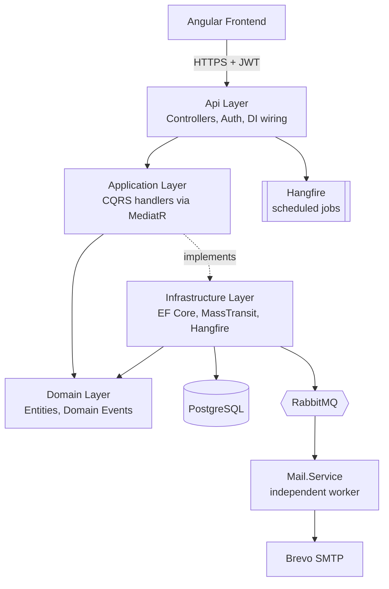
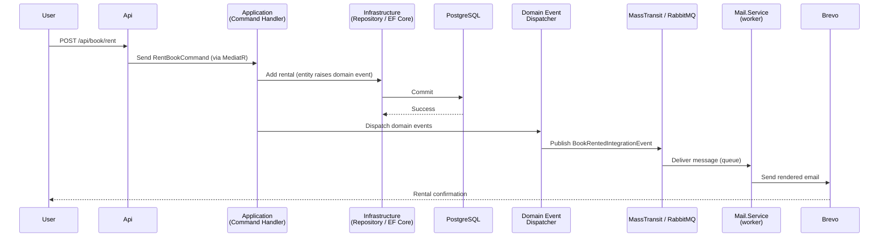

# Library Management System

A full-stack library management system — Angular frontend, ASP.NET Core backend — demonstrating production-grade architecture: Clean Architecture with CQRS via MediatR, a domain layer where entities own their own invariants and raise domain events, event-driven integrations across service boundaries, background job scheduling, and a containerized multi-service deployment.

Users can browse and rent books; admins manage the catalog and user base. Every meaningful action (registration, rentals, returns, due-date reminders) triggers a real transactional email, delivered through an independent worker service — not a mocked side-effect.

## Table of Contents

- [Features](#features)
- [Architecture](#architecture)
- [Tech Stack](#tech-stack)
- [Project Structure](#project-structure)
- [Getting Started](#getting-started)
- [Local Development Setup](#local-development-setup)
- [Configuration](#configuration)
- [API Documentation](#api-documentation)

## Features

**For users**
- Registration and login with JWT authentication
- Browse and search the catalog (by title, author, genre, or ISBN), with server-side pagination
- Rent and return books, with a 30-day loan period
- View active rentals and due dates
- Automatic email notifications: welcome email on signup, rental confirmation, return confirmation, and a reminder a few days before a book is due

**For admins**
- Manage books, authors, and genres (add/edit/delete)
- Search and paginate the books, authors, genres, and users lists in the admin panel — search stays applied while paging through results
- View and manage all registered users, including each user's currently active rentals
- See who currently holds any given book from the catalog view
- Admin accounts aren't self-service — there's no registration flow that can grant admin access; accounts are provisioned directly, by design

## Architecture

The backend follows Clean Architecture, split across four projects with dependencies pointing strictly inward:



Domain and Application have no knowledge of EF Core, MassTransit, or ASP.NET Core — those are Infrastructure and Api concerns, wired together only at the composition root. Every write operation goes through a CQRS command handler; every read through a query handler; MediatR dispatches both.

### Event-driven email notifications

Rather than sending email synchronously inside request handlers (which would couple every write operation to SMTP availability and latency), domain events are raised on the entity, dispatched only *after* a successful database commit, and handled by a completely separate consumer process:



This means the API responds to the user immediately without waiting on an SMTP round-trip, a slow or unreachable mail provider never fails a rental request, and `Mail.Service` can be deployed, scaled, and redeployed completely independently of the API.

The due-soon reminder is the one exception to "events triggered by requests" — it's driven by a **Hangfire recurring job** running daily rather than a real-time trigger. The job checks for rentals due within a catch-up window (not an exact due-date match) specifically so that if the job's host is down when it would normally fire, the next run still catches the reminder rather than silently skipping it.

## Tech Stack

**Backend**
- .NET 10 / ASP.NET Core Web API
- Entity Framework Core + PostgreSQL (Npgsql)
- MediatR (CQRS)
- MassTransit + RabbitMQ (event bus)
- Hangfire (scheduled jobs, backed by PostgreSQL storage)
- MailKit (SMTP delivery)
- BCrypt.Net (password hashing)
- JWT Bearer authentication

**Frontend**
- Angular 22 (standalone components, no NgModules)
- Reactive Forms
- Role-based route guards (Admin / User / authenticated / unauthenticated)

**Infrastructure**
- Docker, with a separate Dockerfile per service (Api, Mail.Service, Frontend)
- nginx (serves the built Angular app and reverse-proxies API calls, so the browser only ever talks to a single origin)
- Docker Compose for local orchestration
- Brevo (transactional email delivery in real environments; MailHog for local dev)

## Project Structure

```
backend/LibraryManagementSystem/src/
├── Api/
│   ├── LibraryManagementSystem.Api             — Controllers, auth wiring, composition root
│   ├── LibraryManagementSystem.Application     — CQRS commands/queries, DTOs, no framework deps
│   ├── LibraryManagementSystem.Domain          — Entities, domain events, repository interfaces
│   └── LibraryManagementSystem.Infrastructure  — EF Core, repositories, MassTransit, Hangfire
└── Mail.Service/
    ├── LibraryManagementSystem.Contracts       — Integration event contracts (shared with Api)
    └── LibraryManagementSystem.MailService     — Independent worker: consumes events, sends email

frontend/library-management-system/            — Angular app

docker/
├── docker-compose.yml
└── .env                                        — not committed; see Configuration
```

## Getting Started

The entire stack runs via Docker Compose — no local .NET or Node installation required to run it (only to develop it).

**Prerequisites:** Docker Desktop, and a Brevo (or any SMTP provider) account if you want real email delivery — otherwise MailHog captures everything locally.

```bash
git clone https://github.com/MarkoKliska/LibraryManagementSystem.git
cd LibraryManagementSystem/docker
# create .env — see Configuration below
docker compose up -d --build
```

Once running:
- Frontend: http://localhost:8081
- API (direct): http://localhost:8080
- MailHog UI (local test inbox): http://localhost:8025
- RabbitMQ management: http://localhost:15672
- pgAdmin: http://localhost:5050

The API applies its own database migrations automatically on startup — no manual `dotnet ef database update` step needed.

## Local Development Setup

Running the full stack via Docker (above) is the fastest way to see the app working, but for active development you'll want the Api, Mail.Service, and frontend running locally with hot reload/debugging, while Postgres, RabbitMQ, MailHog, and pgAdmin still run in Docker.

### Prerequisites

- [.NET 10 SDK](https://dotnet.microsoft.com/download) (all backend projects target `net10.0`)
- Node.js compatible with Angular 22's CLI (`@angular/cli ^22.0.5`) — if `npm install` succeeds but `ng serve` / `npm start` fails with a Node version error, check `node -v` against what the CLI reports it needs
- Docker Desktop (for Postgres, RabbitMQ, MailHog, pgAdmin)

### 1. Start the infrastructure containers

`mailhog` and `pgadmin` are gated behind the `dev` Compose profile, so include it explicitly:

```bash
cd docker
docker compose --profile dev up -d postgres rabbitmq mailhog pgadmin
```

This exposes Postgres on `localhost:5432`, RabbitMQ on `localhost:5672`/`15672`, and MailHog on `localhost:1025`/`8025`. You still need `docker/.env` — see [Configuration](#configuration).

### 2. Configure user secrets

The Api and Mail.Service projects read local secrets via [.NET user secrets](https://learn.microsoft.com/en-us/aspnet/core/security/app-secrets), not `docker/.env` (that file only feeds the containerized build). Each project's `appsettings.Development.json` already sets local defaults (`RabbitMq:Host=localhost`, `Cors:AllowedOrigin=http://localhost:4200` for the Api; `RabbitMq:Host=localhost`, `Smtp:Host=localhost`, `Smtp:Port=1025` for MailHog on Mail.Service) — user secrets just supply the sensitive values.

**Api** (from `backend/LibraryManagementSystem/src/Api/LibraryManagementSystem.Api`):

```bash
dotnet user-secrets set "ConnectionStrings:DefaultConnection" "Host=localhost;Database=LibraryDb;Username=<POSTGRES_USER>;Password=<POSTGRES_PASSWORD>"
dotnet user-secrets set "Jwt:Key" "<a long random string>"
dotnet user-secrets set "RabbitMq:Username" "<RABBITMQ_USER>"
dotnet user-secrets set "RabbitMq:Password" "<RABBITMQ_PASSWORD>"
```

**Mail.Service** (from `backend/LibraryManagementSystem/src/Mail.Service/LibraryManagementSystem.MailService`):

```bash
dotnet user-secrets set "RabbitMq:Username" "<RABBITMQ_USER>"
dotnet user-secrets set "RabbitMq:Password" "<RABBITMQ_PASSWORD>"
dotnet user-secrets set "Smtp:FromAddress" "<any address>"
```

The RabbitMQ/Postgres credentials must match whatever you set in `docker/.env`, since both point at the same containers. Leaving Mail.Service's SMTP settings alone routes email to MailHog (`http://localhost:8025`); set `Smtp:Host`/`Port`/`Username`/`Password` there too if you want real delivery through Brevo instead.

### 3. Trust the HTTPS dev certificate

The Api runs on `https://localhost:7239` via a self-signed dev certificate. If it's untrusted, frontend requests fail with a network error browsers often mislabel as a CORS error:

```bash
dotnet dev-certs https --trust
```

Firefox keeps its own certificate store, so `--trust` alone may not be enough there — open `https://localhost:7239/swagger` directly once and accept the security warning to add a permanent exception.

### 4. Build and run the backend

```bash
cd backend/LibraryManagementSystem
dotnet build LibraryManagementSystem.slnx
```

Then, in separate terminals:

```bash
cd src/Api/LibraryManagementSystem.Api
dotnet run
```

→ `https://localhost:7239`, Swagger at `/swagger`, Hangfire dashboard at `/hangfire` (Development-only). Migrations apply automatically on startup.

```bash
cd src/Mail.Service/LibraryManagementSystem.MailService
dotnet run
```

### 5. Run the frontend

```bash
cd frontend/library-management-system
npm install
npm start
```

→ `http://localhost:4200`, matching the Api's CORS default and the `apiUrl` already set in `environment.ts`.

### Troubleshooting

- **Missing reference assembly errors, or stale build output** — run `dotnet clean`, `dotnet restore`, `dotnet build` on `LibraryManagementSystem.slnx` from the solution root, not a single project.
- **Postgres/pgAdmin containers stuck restarting** — `docker logs library_postgres` will show a missing-password error if `POSTGRES_PASSWORD`/pgAdmin vars aren't in `docker/.env`.
- **`npm start` fails with a Node version error** — Angular's CLI enforces its Node requirement at runtime, not just as an `engines` warning.
- **"CORS request did not succeed" calling the Api from the browser** — almost always the untrusted HTTPS dev cert (step 3), not an actual CORS misconfiguration.

## Configuration

Create `docker/.env` with:

```
POSTGRES_USER=admin
POSTGRES_PASSWORD=admin123
DB_CONNECTION=Host=postgres;Database=LibraryDb;Username=admin;Password=admin123
JWT_KEY=<a long random string>
RABBITMQ_USER=guest
RABBITMQ_PASSWORD=guest
CORS_ALLOWED_ORIGIN=http://localhost:8081
PGADMIN_DEFAULT_EMAIL=<any email>
PGADMIN_DEFAULT_PASSWORD=<any password>
SMTP_HOST=smtp-relay.brevo.com
SMTP_PORT=587
SMTP_USERNAME=<your Brevo SMTP login>
SMTP_PASSWORD=<your Brevo SMTP key>
SMTP_FROM_ADDRESS=<a sender address verified in Brevo>

```

`POSTGRES_USER` / `POSTGRES_PASSWORD` must match the credentials embedded in `DB_CONNECTION` — both feed the same Postgres container.

`.env` is git-ignored; nothing above is committed to the repo.

## API Documentation

Swagger UI is available at `/swagger` when the API runs in `Development` mode (disabled in the containerized `Production` build, consistent with not exposing API docs on a public deployment by default).
